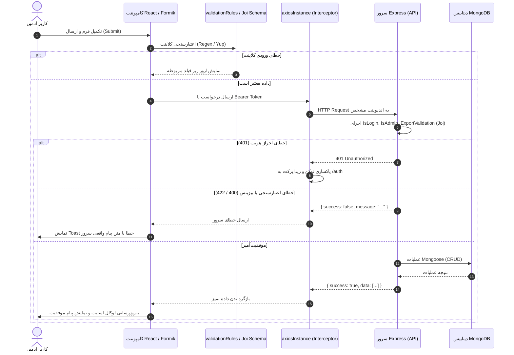

# راهنمای جامع معماری و توسعه داشبورد ادمین کالج رکاد (Admin Overview)

این مستند به عنوان مرجع فنی، معماری و قرارداد ارتباطی میان **داشبورد ادمین (`RokadCollage/Admin`)** و **بک‌اند (`RokadCollage/API`)** تدوین شده است.

---

## ۱. خلاصه‌ی اجرایی و اصول طراحی

داشبورد ادمین بر پایه‌ی React 18 و Tailwind CSS و Vite طراحی شده و با استانداردهای زیر بازنویسی و همگام‌سازی شده است:
1. **قانون تک‌مسئولیتی و سقف خطوط (Single Responsibility ≤ 250 Lines):** تمام فایل‌ها و کامپوننت‌های پنل خرد شده و زیر ۲۵۰ خط کد استاندارد قرار دارند.
2. **قرارداد کامل با بک‌اند واقعی (Backend Contract Fidelity):** تمام مسیرها، ساختار فرم‌ها، اعتبارسنجی‌ها (Joi/Mongoose)، و ساختار خطاها بدون کوچک‌ترین مغایرت با کدهای بک‌اند تنظیم شده‌اند.
3. **امنیت بالا در رندرینگ و کلیدها:**
   - حذف کامل آسیب‌پذیری XSS با جایگزینی `dangerouslySetInnerHTML` توسط کامپوننت امن `<CourseIcon />` (تبدیل به Data URI و عدم اجرای اسکریپت).
   - امن‌سازی آی‌فریم و لینک‌های نقشه با اعتبارسنجی پروتکل (`isSafeHttpUrl`).
   - عدم لود عمومی لایسنس اسپات‌پلیر در لیست‌های عمومی (`select: false`) و واکشی آن صرفاً در مدال اختصاصی `LicenseKeyModal` با دسترسی مجزا.
4. **طراحی زیبا، ریسپانسیو و هماهنگ:** استفاده از توکن‌های استاندارد طراحی، حالت تیره/روشن، پشتیبانی کامل از تاریخ شمسی (`JalaliDatePicker`) و زبان فارسی.

---

## ۲. جدول قرارداد مسیرهای ارتباطی بک‌اند (Backend Contract Table)

| ردیف | ماژول | متد HTTP | اندپوینت API | شرح عملکرد | وضعیت اعتبارسنجی و نکات کلیدی |
| :--- | :--- | :---: | :--- | :--- | :--- |
| **۱** | **احراز هویت** | `POST` | `/api/auth/login` | ورود به پنل | دریافت شماره همراه و رمز عبور؛ ذخیره توکن در `localStorage` |
| **۲** | **کاربران** | `GET` | `/api/user` | لیست کاربران | پشتیبانی از پارامترهای `limit`, `page`, `sort`, `q`, `role` |
| **۳** | **کاربران** | `GET` | `/api/user/:id` | جزئیات یک کاربر | بازیابی مشخصات شناسنامه‌ای و سوابق |
| **۴** | **کاربران** | `POST` | `/api/user` | ایجاد کاربر جدید | فیلدهای `phoneNumber`, `password`, `fullName`, `role`, `birthDate` |
| **۵** | **کاربران** | `PATCH` | `/api/user/:id` | ویرایش کاربر | ویرایش مشخصات و نقش (`user`, `admin`, `superAdmin`) |
| **۶** | **کاربران** | `DELETE` | `/api/user/:id` | حذف کاربر | حذف حساب کاربری با تاییدیه ادمین |
| **۷** | **دوره‌های حضوری** | `GET` | `/api/in-person-courses` | لیست دوره‌های حضوری | فیلتر، صفحه‌بندی و پاپولیت اساتید |
| **۸** | **دوره‌های حضوری** | `GET` | `/api/in-person-courses/:id` | جزئیات دوره حضوری | شامل جلسات (`sessions`)، اسپرینت‌ها، نقشه و مشخصات کامل |
| **۹** | **دوره‌های حضوری** | `POST` | `/api/in-person-courses` | ثبت دوره حضوری جدید | نیاز به آرایه حداقل یک سشن با فیلدهای `code`, `scheduleDays`, `scheduleHours`, `capacity` |
| **۱۰** | **دوره‌های حضوری** | `PATCH` | `/api/in-person-courses/:id` | ویرایش دوره حضوری | به‌روزرسانی مشخصات و مدیریت کدهای کلاسی |
| **۱۱** | **دوره‌های حضوری** | `DELETE` | `/api/in-person-courses/:id` | حذف دوره حضوری | حذف نرم/سخت بر اساس کنترلر |
| **۱۲** | **دوره‌های مجازی** | `GET` | `/api/virtual-courses` | لیست دوره‌های مجازی | فیلتر و جستجوی دوره‌های آنلاین |
| **۱۳** | **دوره‌های مجازی** | `GET` | `/api/virtual-courses/:id` | جزئیات دوره مجازی | شامل `spotplayerCourseId` (هگزادسیمال ۲۴ کاراکتری) |
| **۱۴** | **دوره‌های مجازی** | `POST` | `/api/virtual-courses` | ایجاد دوره مجازی | الزامی بودن فیلد `spotplayerCourseId` در ولیدیشن بک‌اند |
| **۱۵** | **دوره‌های مجازی** | `PATCH` | `/api/virtual-courses/:id` | ویرایش دوره مجازی | ویرایش مشخصات، قیمت، تخفیف و شناسه اسپات‌پلیر |
| **۱۶** | **دوره‌های مجازی** | `DELETE` | `/api/virtual-courses/:id` | حذف دوره مجازی | حذف دوره آنلاین با پاکسازی وابستگی‌ها |
| **۱۷** | **ثبت‌نام‌ها** | `GET` | `/api/enrollments/in-person` | آمار ثبت‌نام حضوری | گروه‌بندی سلسله‌مراتبی دوره -> کد کلاس -> فراگیران |
| **۱۸** | **ثبت‌نام‌ها** | `GET` | `/api/enrollments/virtual` | آمار ثبت‌نام مجازی | گروه‌بندی دوره مجازی -> فراگیران |
| **۱۹** | **ثبت‌نام‌ها** | `GET` | `/api/enrollment/:id` | جزئیات تک ثبت‌نام | **تنها اندپوینتی که کلید `spotplayer.key` را با `+spotplayer.key` بازمی‌گرداند** |
| **۲۰** | **ثبت‌نام‌ها** | `POST` | `/api/enrollments/manual` | ثبت دستی فراگیر | ثبت‌نام مستقیم دانش‌آموز توسط مدیر با انتخاب جلسه/دوره |
| **۲۱** | **ثبت‌نام‌ها** | `DELETE` | `/api/enrollments/:id` | لغو ثبت‌نام | حذف ثبت‌نام و آزادسازی ظرفیت کلاس |
| **۲۲** | **کیف‌پول‌ها** | `GET` | `/api/wallet/all` | لیست کل کیف‌پول‌ها | مشاهده موجودی حساب کاربران (`balance`) همراه پاپولیت کاربر |
| **۲۳** | **کیف‌پول‌ها** | `GET` | `/api/wallet/transactions/all` | گزارش کل تراکنش‌ها | لیست لاگ‌های مالی با وضعیت (`success`, `pending`, `failed`) و مبالغ |
| **۲۴** | **اساتید** | `GET` | `/api/teacher` | لیست اساتید | بازیابی لیست همراه با رزومه، تصویر و تخصص |
| **۲۵** | **اساتید** | `POST` | `/api/teacher` | ایجاد استاد جدید | فرم مالتی‌پارت/متنی اساتید |
| **۲۶** | **اساتید** | `PATCH` | `/api/teacher/:id` | ویرایش مشخصات استاد | به‌روزرسانی اطلاعات فردی و مهارتی |
| **۲۷** | **اساتید** | `DELETE` | `/api/teacher/:id` | حذف استاد | حذف رکورد استاد |
| **۲۸** | **نظرات** | `GET` | `/api/comment` | لیست نظرات کاربران | شامل `courseModel` (`InPersonCourse` یا `VirtualCourse`) |
| **۲۹** | **نظرات** | `POST` | `/api/comment` | ایجاد دیدگاه | ارسال `course`, `courseModel`, `authorName`, `text`, `avatar` |
| **۳۰** | **نظرات** | `PATCH` | `/api/comment/:id` | ویرایش/تایید نظر | تنظیم وضعیت انتشار و تصحیح محتوای دیدگاه |
| **۳۱** | **نظرات** | `DELETE` | `/api/comment/:id` | حذف دیدگاه | پاکسازی نظر از سیستم |
| **۳۲** | **بلاگ‌ها** | `GET` | `/api/blog` | لیست مقالات | نمایش مقالات وبلاگ همراه دسته‌بندی (فیلد content به‌صورت پیش‌فرض حذف شده است) |
| **۳۳** | **بلاگ‌ها** | `POST` | `/api/blog/preview` | پیش‌نمایش پاکسازی‌شده HTML | ارسال content خام، پاکسازی در سرور و دریافت HTML امن (نرخ ۳۰ درخواست در دقیقه) |
| **۳۴** | **بلاگ‌ها** | `POST` | `/api/blog` | ایجاد مقاله جدید | ذخیره دسته‌بندی، عنوان، توضیحات، محتوای HTML امن و تصویر کاور |
| **۳۵** | **بلاگ‌ها** | `PATCH` | `/api/blog/:id` | ویرایش مقاله | به‌روزرسانی محتوای متنی، HTML و تصویر کاور |
| **۳۶** | **بلاگ‌ها** | `DELETE` | `/api/blog/:id` | حذف مقاله | حذف رکورد مقاله و حذف فایل تصویر از سرور |
| **۳۷** | **سئو** | `GET` | `/api/seo` | تنظیمات سئو سایت | دریافت متاتگ‌های اصلی، OG و Twitter Cards |
| **۳۸** | **سئو** | `PATCH` | `/api/seo` | ویرایش تنظیمات سئو | ذخیره تغییرات عمومی متاتگ‌های وب‌سایت |
| **۳۹** | **آپلود فایل** | `POST` | `/api/upload` | آپلود وکتور و تصویر | آپلود تصویر و دریافت آدرس CDN/سرور |

---

## ۳. ساختار فایل‌ها و معماری پوشه‌ها

```
Admin/
├── src/
│   ├── Components/
│   │   ├── AsidePro/                      # منوی سایدبار کناری مدرن و طبقه‌بندی شده
│   │   ├── CourseSessionsManager/         # مدیریت کدهای کلاسی، روزها، ساعات و ظرفیت دوره حضوری
│   │   │   ├── CourseSessionRow.jsx       # کامپوننت نمایش و ویرایش هر ردیف جلسه (<110 خط)
│   │   │   └── index.jsx                  # ارکستراتور جلسات و اعتبارسنجی سشن‌ها (<190 خط)
│   │   ├── SvgIconInput/                  # ورودی آیکون دوره با دو حالت کد SVG و آپلود فایل
│   │   ├── TeacherSelect/                 # کامپوننت انتخاب اساتید با سرچ و پاپولیت چندگانه
│   │   │   ├── SelectedTeachersBadges.jsx # لیست بچ‌های انتخاب‌شده (<40 خط)
│   │   │   ├── TeacherDropdown.jsx        # دراپ‌داون نتایج جستجو (<75 خط)
│   │   │   └── index.jsx                  # کنترلر انتخاب اساتید (<195 خط)
│   │   ├── UI/                            # کتابخانه کامپوننت‌های پایه (Card, Button, Badge, Input, ...)
│   │   │   ├── CourseIcon/                # رندرر وکتور کاملاً امن از طریق SVG Data URI
│   │   │   ├── JalaliDatePicker/          # دیت‌پیکر شمسی استاندارد با توکن طراحی
│   │   │   └── index.js                   # خروجی یکپارچه کامپوننت‌های UI
│   │   └── UserProfileModal/              # مدال جامع پروفایل و تاریخچه مالی فراگیر
│   │       ├── UserEnrollmentList.jsx     # سوابق ثبت‌نام و مبالغ پرداختی کاربر (<65 خط)
│   │       └── index.jsx                  # مدال مشخصات شناسنامه‌ای و آماری (<215 خط)
│   ├── Constants/
│   │   └── validationRules.js             # رجکس‌ها، مقادیر مجاز و خطاهای فارسی هماهنگ با بک‌اند
│   ├── Pages/
│   │   ├── Auth/                          # صفحه ورود ادمین
│   │   ├── Blog/                          # مدیریت مقالات وبلاگ با ویرایشگر HTML و پیش‌نمایش
│   │   │   ├── BlogPage/                  # فهرست مقالات (سرچ، فیلتر، تاریخ شمسی، صفحه‌بندی)
│   │   │   ├── BlogFormPage/              # ترکیب‌کننده فرم ساخت/ویرایش (<210 خط)
│   │   │   ├── components/                # کامپوننت‌های ویرایشگر کد، پیش‌نمایش ایزوله و سربرگ
│   │   │   ├── hooks/useBlogPreview.js    # هوک کش و واکشی لغو‌پذیر پیش‌نمایش از سرور
│   │   │   ├── styles/articleContent.css  # استایل خودکفای مقاله (.article-content)
│   │   │   └── api/blogApi.js             # لایه شبکه اختصاصی مقالات
│   │   ├── Comment/                       # مدیریت دیدگاه‌ها (پشتیبانی InPersonCourse و VirtualCourse)
│   │   │   ├── components/CommentForm.jsx # فرم ماژولار دیدگاه (<180 خط)
│   │   │   ├── CreateComment/             # ایجاد دیدگاه (<110 خط)
│   │   │   └── UpdateComment/             # ویرایش دیدگاه (<140 خط)
│   │   ├── Course/
│   │   │   ├── InPerson/                  # دوره‌های حضوری (لیست، ایجاد، ویرایش، مشاهده)
│   │   │   ├── Virtual/                   # دوره‌های مجازی و ارتباط اسپات‌پلیر
│   │   │   ├── shared/                    # بخش‌های اشتراکی فرم‌ها (قیمت، تخفیف، توضیحات)
│   │   │   └── SingleCourse/components/   # ویجت‌های نمایشی جزئیات دوره (Hero, Location, ...)
│   │   ├── Enrollment/                    # مدیریت ۳-سطحی حضوری و ۲-سطحی مجازی
│   │   │   ├── shared/LicenseKeyModal.jsx # واکشی امن لایسنس اسپات‌پلیر در صورت درخواست
│   │   │   ├── InPersonEnrollmentsTab.jsx # تب دوره‌های حضوری و کدهای کلاسی (<180 خط)
│   │   │   └── VirtualEnrollmentsTab.jsx  # تب دوره‌های مجازی و فراگیران (<195 خط)
│   │   ├── Home/                          # داشبورد اصلی ادمین با کارت‌های آماری ۸ ماژول (<170 خط)
│   │   ├── SeoSettings/                   # مدیریت سئو
│   │   │   ├── components/                # بخش‌های ماژولار (Basic, OpenGraph, Twitter)
│   │   │   └── index.jsx                  # صفحه تنظیمات سئو (<125 خط)
│   │   ├── Teacher/                       # مدیریت اساتید
│   │   ├── User/                          # مدیریت کاربران و سطوح دسترسی
│   │   │   ├── components/UserToolbar.jsx # ابزار جستجو و فیلتر نقش (<25 خط)
│   │   │   └── UserPage/index.jsx         # مدیریت کاربران با اسکرول نامحدود (<245 خط)
│   │   └── Wallet/                        # ماژول جدید کیف‌پول‌ها و تراکنش‌های مالی
│   │       ├── walletApi.js               # لایه شبکه اندپوینت‌های ولت (<55 خط)
│   │       ├── WalletsTable.jsx           # جدول موجودی کیف‌پول‌ها (<100 خط)
│   │       ├── TransactionsTable.jsx      # جدول تاریخچه تراکنش‌ها (<105 خط)
│   │       └── index.jsx                  # صفحه تجمیعی تب‌های ولت (<150 خط)
│   ├── Routes/                            # مسیریابی داشبورد و محافظت ProtectedRoute
│   └── Utils/
│       ├── axiosInstance.js               # نمونه کلاینت Axios با مدیریت 401 خودکار و استخراج خطا
│       ├── getImageUrl.js                 # تبدیل آدرس‌های نسبی به URL مطلق مدیا
│       ├── jalaliDate.js                  # توابع کمکی تبدیل و فرمت تاریخ شمسی
│       └── notify.js                      # نمایش نوتیفیکیشن‌های استاندارد SweetAlert/Toast
```

---

## ۴. چرخه جریان داده (Data Flow Lifecycle)



---

## ۵. راهنمای توسعه‌دهنده برای افزودن یا ویرایش ماژول‌ها

هنگام افزودن ماژول جدید یا توسعه ماژول‌های موجود، موارد زیر را دقیقاً رعایت کنید:

1. **پایبندی به قانون ≤ ۲۵۰ خط:**
   - اگر کامپوننتی به بیش از ۲۵۰ خط نزدیک شد، فوراً بخش‌های مستقل را به پوشه‌ی `components/` در کنار همان صفحه منتقل کنید.
   - فقط کامپوننت‌هایی را در `Components/UI/` یا `Components/` عمومی بگذارید که حداقل در **۳ ماژول مجزا** استفاده شوند.
2. **ارتباط با سرور:**
   - همیشه از نمونه‌ی `axiosInstance` در `Utils/axiosInstance.js` استفاده کنید. هرگز مستقیماً از کتابخانه خام `axios` استفاده نکنید.
   - اندپوینت‌ها را به صورت نسبی بنویسید (مثلاً `wallet/all` یا `in-person-courses`؛ نمونه کلاینت baseURL را از قبل تنظیم کرده است).
3. **اعتبارسنجی و قوانین فرم‌ها:**
   - از ثوابت `safeTextRegex`، `phoneRegex`، `hex24Regex` و آپشن‌های انوم در `Constants/validationRules.js` استفاده کنید تا مغایرتی با اعتبارسنجی‌های Joi سمت سرور پیش نیاید.
4. **رندرینگ امن آیکون و وکتور:**
   - هرگز از `dangerouslySetInnerHTML` برای رندر آیکون دوره یا پیش‌نمایش SVG استفاده نکنید. کامپوننت `<CourseIcon icon={...} />` را فراخوانی کنید.
5. **تاریخ‌های شمسی:**
   - برای فیلدهای ورودی تاریخ (مثل تاریخ تولد، سررسید تخفیف یا تاریخ جلسه)، از `<JalaliDatePicker />` موجود در `Components/UI` استفاده نمایید. مقدار خروجی این کامپوننت ISO استاندارد میلادی است که دیتابیس بدون مشکل می‌پذیرد.

---

## ۶. فهرست محدودیت‌ها و مغایرت‌های فنی بک‌اند (Backend Limitations & Notes)

در حین بررسی عمیق کدهای سرور (`RokadCollage/API`)، موارد زیر شناسایی شدند که در پنل ادمین مدیریت شده‌اند:

1. **مدل چندریختی در ثبت‌نام‌ها و نظرات:**
   - فیلد `courseModel` در نظرات و ثبت‌نام‌ها باید دقیقاً یکی از دو مقدار رشته‌ای `"InPersonCourse"` یا `"VirtualCourse"` باشد. هر مقدار دیگر با ارور اعتبارسنجی دیتابیس روبرو می‌شود.
2. **جلسات دوره حضوری (`sessions`):**
   - در اسکیمای `InPersonCourse`، حداقل یک جلسه با فیلدهای الزامی `code` (یکتا)، `capacity`، `scheduleDays` و `scheduleHours` مورد نیاز است. ارسال آرایه خالی باعث رد شدن درخواست می‌شود.
3. **شناسه اسپات‌پلیر در دوره مجازی:**
   - فیلد `spotplayerCourseId` در اسکیمای `VirtualCourse` الزامی بوده و باید حتماً یک شناسه معتبر ۲۴ رقمی هگزادسیمال مطابق با الگوی شناسه دوره‌های پنل اسپات‌پلیر باشد.
4. **عدم بازگشت مستقیم لایسنس اسپات‌پلیر در لیست‌ها:**
   - در کنترلر `enrollment/all` فیلد `spotplayer.key` برای جلوگیری از نشت اطلاعات حذف (`select: false`) شده است. پنل ادمین این فیلد را منحصراً در صورت کلیک ادمین بر روی دکمه مشاهده لایسنس از طریق `GET /api/enrollment/:id` دریافت و نمایش می‌دهد.
5. **مسیرهای منفرد ماژول‌ها در سرور:**
   - ماژول کاربر بر روی `/api/user` (مفرد) و ماژول استاد بر روی `/api/teacher` (مفرد) مونت شده‌اند، در حالی که ماژول‌های دوره بر روی `/api/in-person-courses` و `/api/virtual-courses` (جمع) قرار دارند. تمام فراخوانی‌های فرانت بر اساس این ساختار دقیق اصلاح شده‌اند.
6. **عدم ارسال فیلد `type` در دوره‌ها:**
   - در اسکیمای مونگوس، مقدار فیلد `type` به صورت خودکار (`default: "حضوری"` یا `"مجازی"`) و تغییرناپذیر (`immutable: true`) تنظیم شده است. ارسال فیلد `type` در `req.body` توسط ولیدیتور Joi بک‌اند رد شده و منجر به خطای `"type" is not allowed` می‌گردد. کلاینت نباید فیلد `type` را در بدنه درخواست ارسال کند. همچنین زیرمجموعه‌های `sprints` و `sessions` نباید حاوی `_id` باشند.
7. **ویرایشگر HTML و پیش‌نمایش امن مقالات وبلاگ:**
   - ویرایشگر مقاله بر پایه‌ی CodeMirror 6 پیاده‌سازی شده و محتوای HTML خام را مدیریت می‌کند. برای جلوگیری کامل از حملات تزریق اسکریپت و XSS، هیچ کدی در DOM اصلی داشبورد با `dangerouslySetInnerHTML` رندر نمی‌شود. پیش‌نمایش صرفاً با ارسال محتوا به اندپوینت `POST /api/blog/preview` و دریافت HTML پاکسازی‌شده از سرور، داخل یک `<iframe>` ایزوله با `sandbox="allow-same-origin"` (بدون دسترسی اجرای اسکریپت) نمایش می‌یابد. فیلد `content` در لیست مقالات برای بهینه‌سازی پهنای باند بازگردانده نمی‌شود.
