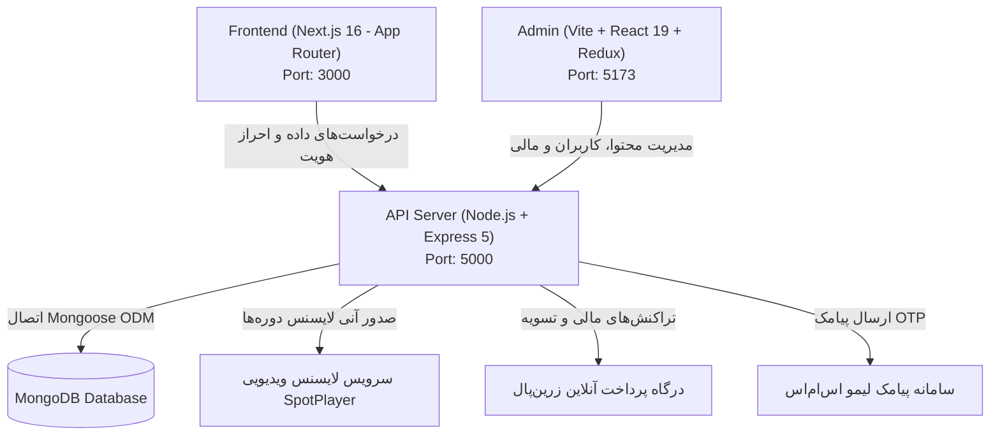

# ساختار کامل مخزن و پروژه کالج رکاد (Rokad Collage)

این سند نقشه راهبردی، شجره‌نامه فایل‌ها، نقش دایرکتوری‌ها و ارتباطات کلیدی میان ۳ بخش اصلی سیستم (بک‌اند API، فرانت‌اند کاربر Next.js و پنل مدیریت Admin) را با شفافیت کامل تشریح می‌کند.

---

## ۱. نمای کلان اکوسیستم (System Architecture Topology)

پروژه کالج رکاد به صورت معماری Monorepo تفکیک‌شده سامان‌دهی شده و از ۳ اپلیکیشن اصلی تشکیل گردیده است:



---

## ۲. درخت پوشه‌ها و نقش بخش‌ها در ریشه مخزن

```
RokadCollage/
├── API/                        # سرور بک‌اند (Node.js / Express 5 / MongoDB)
├── frontend/                   # اپلیکیشن اصلی فرانت‌اند (Next.js 16 با App Router)
├── Admin/                      # پنل مدیریت اختصاصی ادمین (Vite / React 19 / Redux Toolkit / MUI)
├── docker-compose.yml          # فایل ارکستراسیون کانتینرهای داکر
├── Rokad-Final-Design-System.md # سند استاندارد دیزاین سیستم (کنتراست، رنگ‌ها و کامپوننت‌ها)
├── BACKEND_DOCUMENTATION.md    # مستند جامع لاجیک‌ها و معماری بک‌اند
├── FRONTEND_DOCUMENTATION.md   # مستند جامع تمامی صفحات و کامپوننت‌های فرانت‌اند
└── PROJECT_STRUCTURE.md        # همین فایل (ساختار و راهنمای ارتباطات کل سیستم)
```

---

## ۳. کالبدشکافی ساختار بک‌اند (`/API`)

```
API/
├── app.js                      # تنظیمات میانی، هدرهای امنیتی Helmet، روت‌های پایه و مدیریت خطای متمرکز
├── server.js                   # اتصال به دیتابیس، Graceful Shutdown و مدیریت پروسه سرور
├── config.env                  # متغیرهای محیطی (پورت، آدرس دیتابیس، کلید JWT، وب‌سرویس‌ها)
├── .env.example                # تمپلیت استاندارد متغیرهای محیطی
├── Dockerfile                  # تصویر داکر سرویس بک‌اند
├── Middleware/                 # میان‌افزارهای احراز هویت و امنیت
│   ├── IsLogin.js             # اعتبارسنجی JWT کاربر
│   ├── IsAdmin.js             # بررسی دسترسی مدیریت (admin / superAdmin)
│   ├── ExportValidation.js    # اعتبارسنجی توکن‌های اکسپورت اکسل و گزارشات
│   ├── convertToWebp.js       # فشرده‌سازی خودکار تصاویر به WebP با Sharp
│   └── mongoSanitize.js       # خنثی‌سازی حملات NoSQL Injection
├── Modules/                    # ماژول‌های کپسوله‌شده مبتنی بر ویژگی (Feature-based)
│   ├── Auth/                  # ورود پیامکی OTP و رمز عبور (Auth.js, AuthCn.js, AuthValidation.js)
│   ├── User/                  # حساب‌های کاربری و پروفایل (User.js, UserCn.js, UserMd.js)
│   ├── Teacher/               # مدرسان و هیئت علمی (Teacher.js, TeacherCn.js, TeacherMd.js)
│   ├── InPersonCourse/        # دوره‌های حضوری و اسپرینت‌ها (InPersonCourse.js, InPersonCourseCn.js, InPersonCourseMd.js)
│   │   └── CourseSession/     # کدهای کلاس و ظرفیت‌های حضوری (CourseSession.js, CourseSessionCn.js)
│   ├── VirtualCourse/         # دوره‌های ضبط‌شده و فصول ویدیویی (VirtualCourse.js, VirtualCourseCn.js)
│   ├── CourseCore/            # موتور محاسباتی مشترک خرید و تخفیف‌ها (purchaseCore.js, courseBase.js)
│   ├── Enrollment/            # دوره‌های خریداری‌شده دانشجو و لایسنس اسپات‌پلیر (Enrollment.js, EnrollmentCn.js)
│   ├── Payment/               # چرخه‌ی خرید مستقیم و تسویه زرین‌پال (PaymentRoutes.js, PaymentCn.js)
│   ├── Wallet/                # کیف پول و تاریخچه تراکنش‌ها (Wallet.js, WalletCn.js, TransactionMd.js)
│   ├── Blog/                  # مقالات و اخبار آموزشی (Blog.js, BlogCn.js, BlogMd.js)
│   ├── Comment/               # نظرات و رضایت دانشجویان (Comment.js, CommentCn.js, CommentMd.js)
│   ├── CourseComment/         # پرسش و پاسخ تخصصی دوره‌ها با ساپورت پاسخ تو در تو
│   ├── Seo/                   # تنظیمات متاتگ‌های سئو به‌صورت Singleton
│   └── Upload/                # سرویس بارگذاری فایل و حذف ایمن از دیسک
├── Public/                     # فایل‌های استاتیک عمومی، آواتارها و تصاویر دوره‌ها
└── Utils/                      # توابع کمکی
    ├── discountHelper.js      # محاسبه هوشمند قیمت تخفیف‌دار و اعتبارسنجی کوپن
    ├── fileHelper.js          # پاک‌سازی و جابجایی فایل‌های آپلودی
    ├── htmlSanitizer.js       # پاک‌سازی محتوا از کدهای مخرب
    ├── profanityFilter.js     # پالایش کلمات نامناسب در دیدگاه‌ها
    ├── sessionHelper.js       # ابزارهای کمکی جلسات حضوری
    ├── SmsHandler.js          # اتصال به درگاه پیامک لیمو اس‌ام‌اس
    ├── spotplayer.js          # وب‌سرویس صدور و استعلام لایسنس اسپات‌پلیر
    ├── Swagger.js             # پیکربندی مستندات تعاملی Swagger
    ├── uploadConfig.js        # تعیین سقف حجم فایل و فرمت‌های مجاز
    └── validateRequest.js     # ارزیابی اسکیماهای Joi روی پارامترها و بدنه ریکوئست
```

---

## ۴. کالبدشکافی ساختار فرانت‌اند کاربر (`/frontend`)

فرانت‌اند مدرن با **Next.js 16 (React 19)** و معماری **App Router** طراحی شده است:

```
frontend/
├── package.json               # ملزومات: Next 16, React 19, Tailwind CSS v4, Lucide Icons, Swiper
├── next.config.mjs            # پیکربندی ریدایرکت‌ها، بهینه‌سازی تصاویر و بسته‌های وب‌پک/توربوپک
├── src/
│   ├── app/                   # App Router اصلی برنامه
│   │   ├── layout.js          # روت اصلی به همراه تمپلیت فونت و متادیتا
│   │   ├── globals.css        # تنظیمات تایپوگرافی، متغیرهای رنگی و استایل‌های عمومی
│   │   ├── fonts.js           # فونت‌های محلی استاندارد
│   │   ├── auth/              # صفحه ورود و ثبت‌نام پیامکی کاربر (/auth)
│   │   └── (main)/            # صفحات دارای هدر و فوتر یکپارچه
│   │       ├── layout.js      # گنجاندن هدر، فوتر، مودال مشاوره و توست‌های سراسری
│   │       ├── page.js        # صفحه اصلی وب‌سایت (Landing Page)
│   │       ├── courses/       # هاب دوره‌های آموزشی (/courses)
│   │       │   └── [slug]/    # صفحه تکی نمایش جزئیات دوره (/courses/:slug)
│   │       ├── dept/[id]/     # لندینگ اختصاصی دپارتمان‌های آموزشی (/dept/:id)
│   │       ├── blog/          # وبلاگ و لیست مقالات آموزشی (/blog)
│   │       │   └── [slug]/    # متن کامل مقاله (/blog/:slug)
│   │       ├── my-courses/    # پنل یادگیری و لیست دوره‌های خریداری‌شده دانشجو
│   │       ├── profile/       # ویرایش مشخصات فردی و تغییر رمز عبور
│   │       └── payment/callback/ # صفحه اعتبارسنجی بازگشت از زرین‌پال و صدور لایسنس
│   ├── components/            # کامپوننت‌های اشتراکی UI
│   │   ├── Header/            # نوبار اصلی، منوی همبرگری، دکمه ورود/پروفایل و سرچ سریع
│   │   ├── Footer/            # فوتر اختصاصی، لینک‌های دسترسی سریع، شبکه‌های اجتماعی
│   │   ├── VideoPlayerModal/  # پلیر پیش‌نمایش ویدیوهای معرفی دوره
│   │   ├── ConsultationModal/ # فرم درخواست مشاوره تلفنی فوری
│   │   └── BrandButton.jsx, OffsetCard.jsx, StickerCard.jsx # المان‌های هویت بصری رکاد
│   ├── legacy-pages/          # کلاینت‌کامپوننت‌های ماژولار بازنویسی‌شده برای App Router
│   │   ├── Home/              # سکشن‌های صفحه اصلی (Hero, Courses, Departments, About, Faq...)
│   │   ├── CourseSingle/      # تفکیک ویوی دوره‌های حضوری و دوره‌های مجازی آنلاین
│   │   ├── CoursesPage/       # فیلترها، اسلایدرها و هاب جامع دوره‌ها
│   │   ├── DepartmentPage/    # لندینگ‌های تخصصی (برنامه‌نویسی، طراحی، هوش مصنوعی...)
│   │   ├── BlogIndex/         # شبکه مقالات و مقالات پربازدید
│   │   └── Checkout/          # مودال تسویه حساب و اتصال به زرین‌پال
│   ├── services/              # لایه سرویس‌های ارتباطی با بک‌اند (API Services)
│   │   ├── authService.js     # ارسال کد OTP، لاگین و بازیابی رمز
│   │   ├── courseService.js   # دریافت لیست دوره‌ها و فیلترها
│   │   ├── enrollmentService.js # خرید دوره، تاییدیه پرداخت و دریافت لایسنس اسپات‌پلیر
│   │   ├── userService.js     # خواندن و آپدیت مشخصات کاربری
│   │   ├── blogService.js     # واکشی مقالات وبلاگ
│   │   └── walletService.js   # ارتباط با کیف پول
│   ├── data/                  # استیت منیجمنت کلاینت و داده‌های ایستا
│   │   ├── panelStore.js      # استور مرکزی کلاینت با رویدادهای سفارشی (`rokad_panel_store_changed`)
│   │   └── selectors.js       # متدهای کمکی جهت بررسی وضعیت لاگین، لایسنس و نشان‌شده‌ها
│   └── lib/                   # کلاینت Axios و کتابخانه‌های کمکی (`api.js`, `clsx.js`)
```

---

## ۵. کالبدشکافی ساختار پنل ادمین (`/Admin`)

پنل مدیریت پیشرفته با پشته فنی **React 19 + Vite + Redux Toolkit + Material UI + Tailwind CSS**:

```
Admin/
├── src/
│   ├── main.jsx               # نقطه ورود به همراه Provider ریداکس
│   ├── Routes/index.jsx       # مسیریاب با استفاده از `createBrowserRouter` و بارگذاری تنبل (Lazy Loading)
│   ├── Layout/                # پوسته اصلی ادمین شامل سایدبار کناری، نوار وضعیت بالا و دارک/لایت مود
│   ├── Store/                 # مدیریت وضعیت با Redux Toolkit
│   │   ├── store.js           # استور مرکزی
│   │   └── Slices/authSlice.js # وضعیت احراز هویت ادمین و سطح نقش
│   ├── Pages/                 # صفحات مستقل بخش‌های مدیریتی
│   │   ├── Auth/              # فرم ورود امن ادمین با اعتبارسنجی Yup
│   │   ├── Home/              # داشبورد آماری، نمودارهای فروش و شاخص‌های کلیدی
│   │   ├── Course/            # تفکیک ساختار دوره‌های حضوری و مجازی
│   │   │   ├── InPerson/      # ایجاد، ویرایش و مدیریت کدهای کلاس حضوری
│   │   │   └── Virtual/       # سرفصل‌بندی، آپلود ویدیو و اتصال اسپات‌پلیر
│   │   ├── Enrollment/        # لیست دانشجویان، وضعیت لایسنس‌ها، صدور دستی یا تلاش مجدد
│   │   ├── User/              # مدیریت کاربران، ارتقا به مدیر و غیرفعال‌سازی
│   │   ├── Teacher/           # افزودن مدرس، مدیریت درصدها و بیوگرافی
│   │   ├── Comment/           # مدیریت رضایت دانشجویان و نظرات سایت
│   │   ├── CourseComment/     # تالار گفتگو و پاسخ به سوالات درسی دانشجویان
│   │   ├── Blog/              # درج مقاله با ویرایشگر کد و متن غنی
│   │   ├── Wallet/            # تراکنش‌های مالی، مدیریت موجودی‌ها و واریزها
│   │   └── SeoSettings/       # مدیریت سئو، متاتگ‌ها و تصاویر شبکه‌های اجتماعی
│   ├── Components/            # کامپوننت‌های فرمیک، جدول‌ها با قابلیت جستجو، فیلتر و صفحه‌بندی
│   └── Utils/                 # ارتباط با Axios، تبدیل تاریخ شمسی (Jalali) و نوتیفیکیشن‌های SweetAlert2
```

---

## ۶. ارتباطات و گردش داده در سیستم

۱. **فرآیند احراز هویت در فرانت‌اند و انتقال به بک‌اند:**
   - فرانت‌اند درخواست OTP را به `/api/auth` ارسال می‌کند.
   - پس از ارسال کد پیامکی توسط LimoSMS، کاربر کد را در فرم وارد نموده و پس از پاسخ موفقیت‌آمیز، توکن JWT در `localStorage` و کوکی فرانت‌اند ذخیره می‌شود.
   - در تمام ریکوئست‌های بعدی هدر `Authorization: Bearer <token>` الصاق می‌گردد.

۲. **فرآیند خرید دوره و صدور لایسنس (Enrollment Flow):**
   - کاربر در صفحه دوره دکمه خرید را کلیک می‌کند.
   - مودال `CheckoutModal` باز شده و در صورت لزوم کد تخفیف اعمال می‌شود.
   - سرویس `checkoutCourse` روت `/api/payment/checkout-request` را فراخوانی می‌کند.
   - زرین‌پال شناسه `Authority` را صادر نموده و کاربر به درگاه منتقل می‌شود.
   - پس از پرداخت، کاربر به `/payment/callback` هدایت می‌شود؛ کلاینت این صفحه سریعاً با فراخوانی `/api/payment/checkout-verify` تراکنش را ثبت و لایسنس اختصاصی SpotPlayer را برای کاربر تولید می‌کند.
   - کاربر مستقیماً کلید لایسنس و لینک دانلود نرم‌افزار را دریافت نموده و دوره در صفحه «دوره‌های من» در دسترس قرار می‌گیرد.
